# E-Dziennik: dokumentacja

E-Dziennik to dziennik lekcyjny w postaci aplikacji internetowej: oceny z historią zmian, uwagi, klasy, przedmioty i przydziały nauczania, z osobnym panelem dla administratora, nauczyciela, ucznia i rodzica.

**Przedmiot:** Programowanie w zastosowaniach, WSB Poznań
**Grupa:** K37_9
**Baza danych:** `wsb_2026_k37_9`
**Zespół:** [DO UZUPEŁNIENIA: imię i nazwisko 1], [DO UZUPEŁNIENIA: imię i nazwisko 2], [DO UZUPEŁNIENIA: imię i nazwisko 3]

**Technologie:** HTML5, CSS3 (własny arkusz stylów, bez frameworków), PHP 8.2–8.5, MariaDB, Laravel 12. Uruchomienie opisuje plik `README.md`.

Pełna wersja dokumentacji (wersja 1.2) z omówieniem wszystkich diagramów: [Dokumentacja_E-Dziennik.docx](Dokumentacja_E-Dziennik.docx). Ten plik jest jej skrótem; rysunki mają te same numery i podpisy.

**Konwencje:** pulpit to strona startowa roli wyświetlana po zalogowaniu, a panel – wszystkie strony dostępne dla danej roli. Nazwy z kodu zapisano czcionką o stałej szerokości. Komunikaty aplikacji są cytowane bez kropki końcowej.

## Spis treści

1. [Konta testowe](#konta-testowe)
2. [Funkcje według ról](#funkcje-według-ról)
3. [Pokrycie wymagań](#pokrycie-wymagań)
4. [Model przypadków użycia](#model-przypadków-użycia)
5. [Architektura systemu](#architektura-systemu)
6. [Model danych](#model-danych)
7. [Kluczowe procesy](#kluczowe-procesy)
8. [Wyrażenia regularne](#wyrażenia-regularne)
9. [Zrzuty ekranu](#zrzuty-ekranu)

## Konta testowe

Hasło każdego konta: `haslo123`

| Adres e-mail | Rola | Opis konta |
|---|---|---|
| `admin@wsb.pl` | Administrator | pełny dostęp: użytkownicy, klasy, przedmioty, przydziały, oceny, statystyki |
| `nauczyciel@wsb.pl` | Nauczyciel | uczy matematyki w klasach 1A, 2B i 3Ti oraz informatyki w 1A i 2B; wychowawczyni klasy 1A |
| `uczen@wsb.pl` | Uczeń | Jan Kowalski z klasy 1A: oceny, historia, uwagi |
| `rodzic@wsb.pl` | Rodzic | Ewa Kowalska: dzieci Jan (1A) i Zofia (2B) |

## Funkcje według ról

**Administrator**
- pulpit ze statystykami, średnią ważoną klas i ostatnimi zmianami ocen,
- pełne zarządzanie użytkownikami: rejestracja konta dowolnej roli (także kolejnego administratora), lista z wyszukiwarką, filtrami i paginacją, podgląd, edycja, usuwanie,
- zarządzanie klasami, przedmiotami i przydziałami nauczania,
- wpisywanie ocen w dowolnej klasie i przedmiocie (także zbiorczo), podgląd całej historii zmian, podgląd i usuwanie uwag.

**Nauczyciel**
- pulpit z przydziałami, średnimi i ostatnimi wpisami,
- arkusz ocen klasy oraz dodawanie, edycja i usuwanie ocen w ramach własnych przydziałów,
- wpis zbiorczy (oceny dla całej klasy naraz),
- historia zmian ocen, pochwały i uwagi,
- panel wychowawcy (tylko odczyt): średnie uczniów ze wszystkich przedmiotów, ich oceny i uwagi.

**Uczeń:** pulpit, oceny według przedmiotów ze średnią ważoną, historia zmian własnych ocen, własne uwagi. Tylko odczyt.

**Rodzic:** pulpit z listą dzieci, a dla każdego dziecka oceny, historia zmian, uwagi i dane wychowawcy. Tylko odczyt.

**Każda rola:** zmiana własnego hasła.

## Pokrycie wymagań

Sformułowania prowadzącego przytoczone dosłownie ujęto w cudzysłów.

| ID | Wymaganie | Ekran | Plik |
|---|---|---|---|
| W1 | System rejestracji i logowania oparty na bazie danych, „szyfrowanie hasła” | Logowanie; rejestracja wewnętrzna w panelu administratora | `LoginController`, `AdminUserController` |
| W2 | Dodawanie użytkowników (przez rejestrację lub przez administratora), „szyfrowanie hasła” | Użytkownicy → Rejestracja użytkownika | `AdminUserController@store`, rzutowanie `hashed` w modelu `User` |
| W3 | Co najmniej trzy poziomy uprawnień | Cztery role | `User::ROLES`, `EnsureUserHasRole` |
| W4 | Różne strony po zalogowaniu, zależnie od uprawnień | Cztery pulpity | `User::dashboardRoute()`, `LoginController@store` |
| W5 | CRUD użytkowników, lista wszystkich i podgląd pojedynczego użytkownika | Użytkownicy | `AdminUserController`, `resources/views/admin/users` |
| W6 | Walidacja wymaganych pól formularzy | Każdy formularz | `app/Http/Requests`, atrybuty HTML5 |
| W7 | Wzorzec MVC | Cała aplikacja | `app/Models`, `resources/views`, `app/Http/Controllers` |
| W8 | Funkcje zgodne z przeznaczeniem systemu | Klasy, przedmioty, przydziały, oceny, uwagi | `SchoolClassController`, `SubjectController`, `TeachingAssignmentController`, `NoteController` |
| W9 | Wpisywanie ocen w klasach (nauczyciel, administrator) | Oceny → arkusz ocen | `GradeController`, `BulkGradeController` |
| W10 | Wyświetlanie ocen (uczeń) | Moje oceny | `StudentDashboardController@grades` |
| W11 | Historia modyfikacji ocen (nauczyciel, uczeń) | Historia zmian | `GradeObserver`, `GradeHistory`, `GradeHistoryController` |
| W12 | Zaawansowane funkcje | Wpis zbiorczy, arkusz ocen, panel wychowawcy, statystyki, średnie ważone | `BulkGradeController`, `HomeroomController`, `GradeAverageCalculator` |
| W13 | Wyrażenia regularne | Formularze użytkownika, klasy, przedmiotu i hasła | `App\Support\ValidationPatterns` |
| W14 | Paginacja i wyszukiwarka | Użytkownicy, klasy, przedmioty, przydziały, oceny, uwagi, historia | `User::scopeSearch()`, `paginate()`, `resources/views/pagination` |
| W15 | HTML5, CSS3, PHP 8.x, MariaDB, Laravel 10 lub nowszy | Cała aplikacja | `composer.json`, `public/css/app.css` |
| W16 | Baza `wsb_2026_k37_9`, użytkownik `root` bez hasła, XAMPP | Konfiguracja | `.env`, `database/dump` |
| W17 | Krótka dokumentacja z opisem funkcji | Ten dokument | `docs/dokumentacja.md`, `README.md` |
| W18 | Obrona: modyfikacja kodu bez dostępu do internetu | Brak zależności sieciowych | `docs/przewodnik-po-kodzie.md` |

Rejestracja jest wewnętrzna: konta zakłada administrator, co dopuszcza wymaganie W2. Publicznej trasy rejestracji nie ma: adres `/register` zwraca stronę 404.

## Model przypadków użycia

Diagram pokazuje, kto korzysta z systemu i jakie cele w nim realizuje. Nie pokazuje kolejności kroków – tę opisują diagramy w rozdziale [Kluczowe procesy](#kluczowe-procesy).

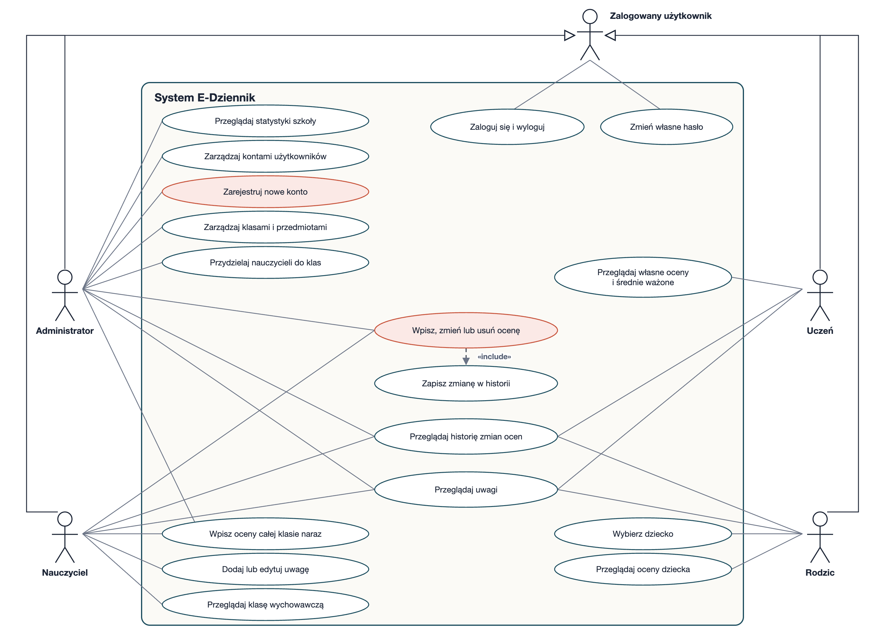

*Rysunek 1. Diagram przypadków użycia systemu E-Dziennik*

**Jak czytać diagram:**
- prostokąt „System E-Dziennik” to granica systemu; elipsy wewnątrz to przypadki użycia, a postacie na zewnątrz to aktorzy,
- linia ciągła (asocjacja) oznacza, że aktor korzysta z danego przypadku użycia,
- strzałka z pustym grotem oznacza uogólnienie: każda rola jest szczególnym przypadkiem aktora „Zalogowany użytkownik”,
- przerywana strzałka z etykietą «include» wskazuje przypadek, który jest zawsze wykonywany w ramach innego.

**Wnioski:**
- logowanie, wylogowanie i zmiana hasła są wspólne dla wszystkich ról dzięki uogólnieniu,
- zarządzanie szkołą (konta, klasy, przedmioty, przydziały) należy wyłącznie do administratora,
- relacja «include» gwarantuje, że każda zmiana oceny trafia do historii (W11),
- uczeń i rodzic korzystają wyłącznie z przypadków użycia polegających na odczycie danych.

## Architektura systemu

E-Dziennik jest aplikacją monolityczną w Laravelu, zbudowaną zgodnie ze wzorcem MVC. Wzorzec dzieli aplikację na trzy warstwy:
- **Model** opisuje dane i reguły; jedna klasa modelu odpowiada jednej tabeli bazy danych.
- **Widok** odpowiada za wygląd strony (szablony Blade).
- **Kontroler** przyjmuje żądanie, korzysta z modeli i wybiera widok.

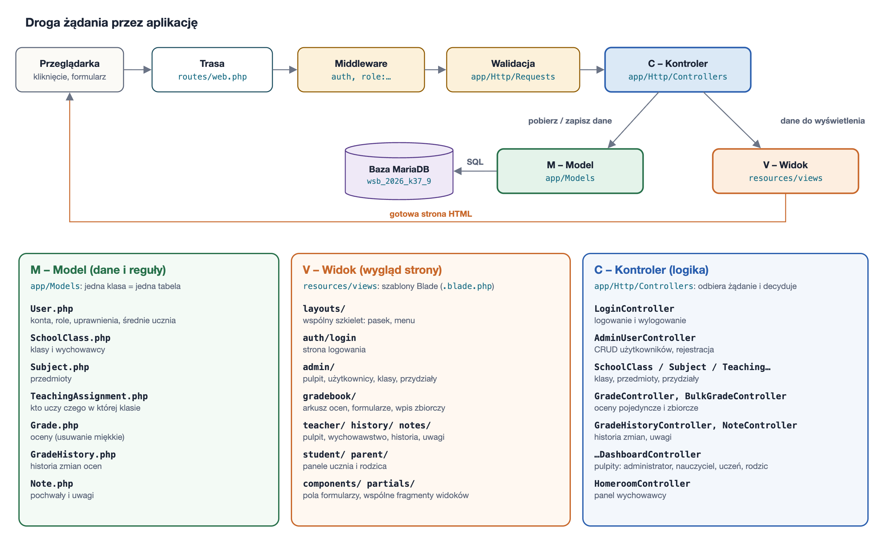

*Rysunek 2. Architektura aplikacji: droga żądania i pliki warstw MVC*

**Jak czytać diagram:**
- górna część pokazuje, przez co przechodzi jedno żądanie: trasa w `routes/web.php`, middleware sprawdzające logowanie i rolę, walidacja (Form Request), kontroler, model z bazą MariaDB i widok zwracający stronę HTML,
- dolna część przypisuje pliki do warstw Model (zielona), Widok (pomarańczowa) i Kontroler (niebieska).

**Wnioski** – z diagramu wynikają zasady projektowe aplikacji:
- kontrolery tylko koordynują pracę i nie zawierają reguł biznesowych,
- reguły dotyczące danych i uprawnień należą do modeli, np. `User::canGrade()`,
- walidacja jest w klasach Form Request, zapis historii ocen w obserwatorze modelu, a obliczenia średnich w serwisie `GradeAverageCalculator`,
- widoki odpowiadają wyłącznie za prezentację danych.

## Model danych

Baza zawiera osiem tabel dziennika. Konta wszystkich ról są w jednej tabeli `users` i różnią się wartością w kolumnie `role`.

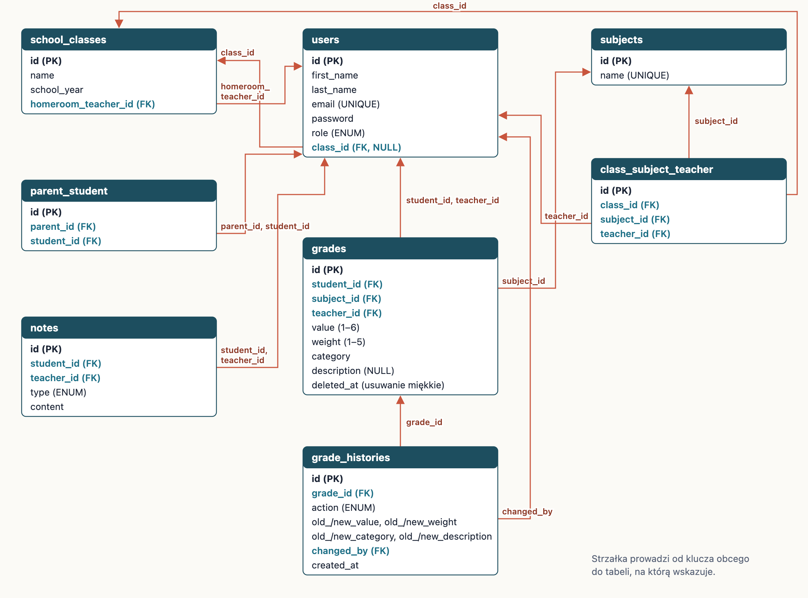

*Rysunek 3. Schemat bazy danych `wsb_2026_k37_9` (diagram związków encji)*

**Jak czytać diagram:**
- prostokąt to tabela; PK oznacza klucz główny, a FK – klucz obcy,
- strzałka prowadzi od klucza obcego do tabeli, na którą wskazuje; etykieta przy strzałce to nazwa kolumny.

| Tabela | Przeznaczenie |
|---|---|
| `users` | konta wszystkich ról |
| `school_classes` | klasy i ich wychowawcy |
| `subjects` | przedmioty |
| `class_subject_teacher` | przydział: kto uczy jakiego przedmiotu w jakiej klasie |
| `parent_student` | powiązania rodzic–uczeń (wiele do wielu) |
| `grades` | oceny; usuwanie miękkie (ang. soft delete) przez kolumnę `deleted_at` |
| `grade_histories` | każda zmiana oceny |
| `notes` | pochwały i uwagi |

**Wnioski:**
- centralną tabelą jest `users`, z którą łączy się większość pozostałych tabel,
- `class_subject_teacher` i `parent_student` to tabele łączące: pierwsza zapisuje przydziały nauczania, druga realizuje relację wiele do wielu między rodzicami a uczniami,
- `users` i `school_classes` wskazują na siebie nawzajem (klasa ucznia oraz wychowawca klasy), dlatego kolumnę `users.class_id` dodaje osobna migracja.

## Kluczowe procesy

Diagramy aktywności (rysunki 4 i 5) pokazują kroki i decyzje procesu, diagram sekwencji (rysunek 6) – współpracę warstw aplikacji, a diagram stanów (rysunek 7) – zmiany, jakim podlega ocena.

### Logowanie

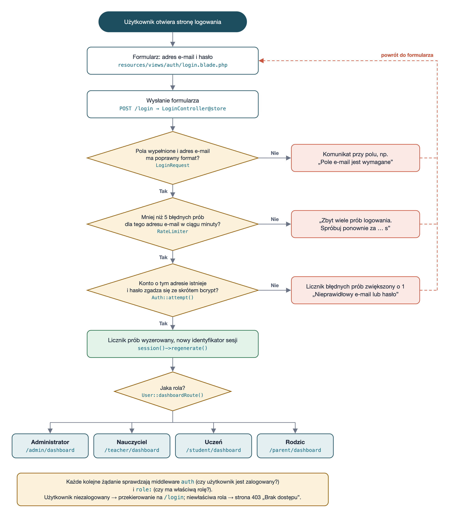

*Rysunek 4. Diagram aktywności: logowanie*

**Jak czytać diagram:**
- zaokrąglony prostokąt oznacza początek lub koniec procesu, zwykły prostokąt – krok, a romb – decyzję z wyjściami „Tak” i „Nie”,
- czerwone prostokąty to komunikaty błędów, a przerywana czerwona strzałka – powrót do formularza,
- pod opisem kroku podano plik lub metodę, która go realizuje.

**Przebieg procesu:** formularz trafia do `LoginController@store`. Najpierw `LoginRequest` sprawdza, czy pola są wypełnione, a adres e-mail ma poprawny format. Potem `RateLimiter` blokuje logowanie po pięciu nieudanych próbach na jedno konto w ciągu minuty, a `Auth::attempt()` porównuje hasło ze skrótem bcrypt zapisanym w bazie. Po udanym logowaniu sesja otrzymuje nowy identyfikator, a `User::dashboardRoute()` przenosi użytkownika na pulpit jego roli. Każde kolejne żądanie sprawdzają middleware `auth` i `role:`.

**Wnioski:**
- każdy błąd kończy się powrotem do formularza z komunikatem, a wpisany adres e-mail pozostaje w polu,
- limit prób jest sprawdzany przed porównaniem hasła, co utrudnia odgadywanie haseł,
- samo zalogowanie nie daje dostępu do paneli innych ról, ponieważ każde kolejne żądanie jest ponownie sprawdzane.

### Rejestracja użytkownika

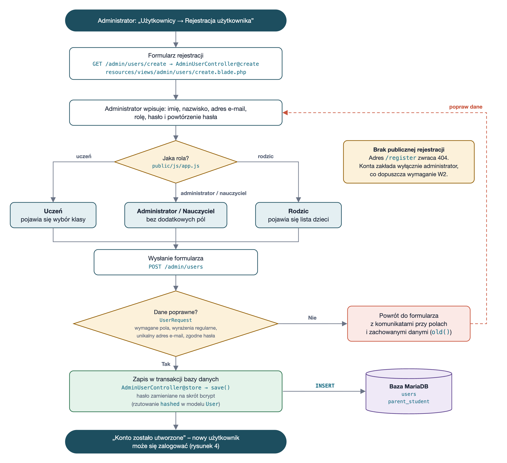

*Rysunek 5. Diagram aktywności: rejestracja użytkownika przez administratora*

**Jak czytać diagram:** oznaczenia są takie same jak na rysunku 4; cylinder oznacza bazę danych, a żółta ramka po prawej stronie – uzasadnienie decyzji projektowej.

**Przebieg procesu:** konta zakłada wyłącznie administrator („Użytkownicy → Rejestracja użytkownika”). Po wyborze roli formularz pokazuje wybór klasy (uczeń) albo listę dzieci (rodzic). Klasa `UserRequest` sprawdza dane, a metoda `AdminUserController@store` zapisuje konto w jednej transakcji. Hasło jest automatycznie zamieniane na skrót bcrypt dzięki rzutowaniu `'password' => 'hashed'` w modelu `User`. Na koniec pojawia się komunikat „Konto zostało utworzone”.

**Wnioski:**
- szkoła kontroluje, kto i z jaką rolą ma dostęp do dziennika (W2),
- serwer sprawdza dane niezależnie od przeglądarki, więc nie da się utworzyć ucznia bez klasy ani rodzica bez dziecka,
- hasło nigdy nie trafia do bazy jako tekst jawny.

### Zapis oceny

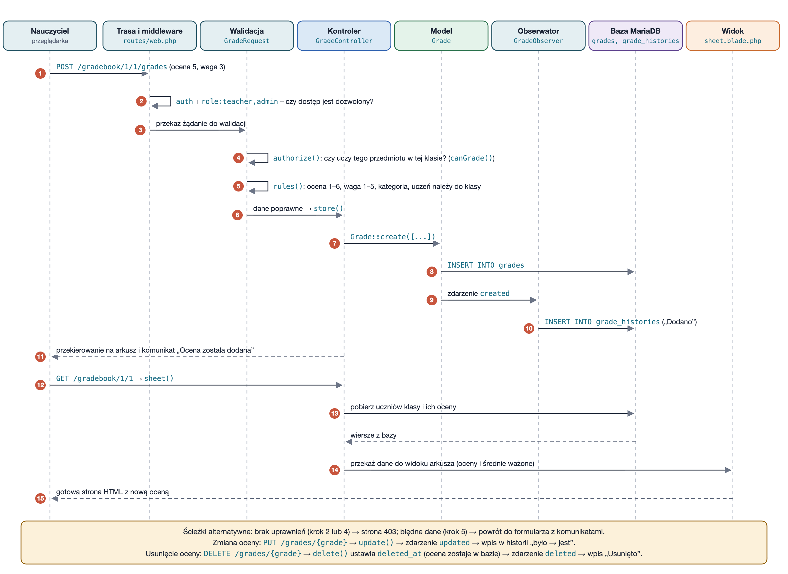

*Rysunek 6. Diagram sekwencji: zapis nowej oceny*

**Jak czytać diagram:**
- prostokąty u góry to uczestnicy: przeglądarka nauczyciela oraz kolejne warstwy aplikacji; czas płynie z góry na dół,
- strzałka ciągła oznacza wywołanie, a strzałka przerywana – odpowiedź lub przekierowanie,
- numery w kółkach wyznaczają kolejność kroków, a żółta ramka na dole opisuje ścieżki alternatywne.

**Przebieg procesu:** nauczyciel w arkuszu klasy wybiera „Dodaj ocenę” i wysyła formularz.

1. **Trasa** `POST /gradebook/{class}/{subject}/grades` w `routes/web.php` wskazuje `GradeController@store`.
2. **Middleware** `auth` i `role:teacher,admin` przepuszczają tylko zalogowanego nauczyciela lub administratora.
3. **Form Request** `GradeRequest` sprawdza, czy nauczyciel uczy tego przedmiotu w tej klasie (`User::canGrade()`), oraz dane: zakres oceny i wagi, kategorię i przynależność ucznia do klasy.
4. **Kontroler** `GradeController@store` wywołuje model i przekierowuje na arkusz.
5. **Model** `Grade::create()` zapisuje ocenę w bazie.
6. **Obserwator** `GradeObserver@created` dopisuje wpis „Dodano” do tabeli `grade_histories`.
7. **Widok** `gradebook/sheet.blade.php` pokazuje arkusz z nową oceną i przeliczoną średnią ważoną.

**Wnioski:**
- uprawnienia są sprawdzane dwa razy: najpierw rola, potem prawo do konkretnej klasy i przedmiotu, dlatego zmiana adresu w przeglądarce nie pozwala wpisać oceny poza własnymi przydziałami,
- historię zapisuje obserwator, więc każda droga zmiany oceny (formularz, wpis zbiorczy, edycja, usunięcie) trafia do historii (W11),
- po zapisie aplikacja przekierowuje na arkusz (wzorzec Post/Redirect/Get), dzięki czemu odświeżenie strony nie dodaje oceny drugi raz.

### Cykl życia oceny

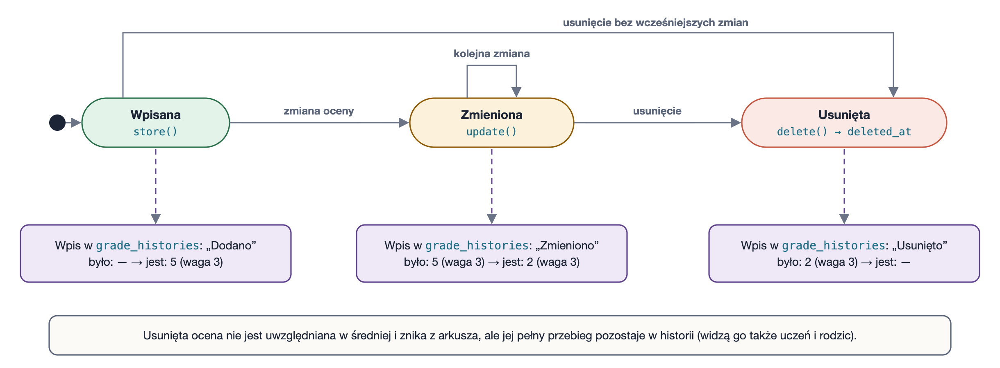

*Rysunek 7. Diagram stanów: cykl życia oceny i wpisy w historii zmian*

**Jak czytać diagram:**
- zaokrąglone prostokąty to stany oceny, a czarne kółko – początek; pod nazwą stanu podano metodę, która do niego prowadzi,
- fioletowe prostokąty to wiersze zapisywane w tabeli `grade_histories` przy danym przejściu.

**Wnioski:**
- ocenę można zmieniać wielokrotnie, a usunąć – zarówno po zmianach, jak i bez nich,
- oceny podlegają usuwaniu miękkiemu: wiersz zostaje w bazie z datą w kolumnie `deleted_at`, a ocena nie jest uwzględniana w średniej,
- każde przejście zostawia wpis w historii, dlatego jest ona kompletna od wpisania oceny do jej usunięcia.

## Wyrażenia regularne

Wzorce są w klasie `ValidationPatterns` (`app/Support/ValidationPatterns.php`). Ten sam wzorzec jest używany w regule walidacji na serwerze i w atrybucie `pattern` w formularzu HTML.

| Pole | Wzorzec | Akceptowane | Odrzucane |
|---|---|---|---|
| Imię, nazwisko | `^\p{Lu}[\p{L}'\-]+(?: \p{Lu}[\p{L}'\-]+)*$` | `Anna`, `Nowak-Kowalska` | `anna`, `Jan123` |
| Hasło | `^(?=.*\p{L})(?=.*\d).{8,}$` | `haslo123` | `abcdefgh`, `1234567` |
| Nazwa klasy | `^[1-8][A-Z][A-Za-z]{0,2}$` | `1A`, `3Ti` | `A1`, `9Z` |
| Rok szkolny | `^(20\d{2})/(20\d{2})$` oraz warunek, że lata następują po sobie | `2026/2027` | `2026/2028`, `26/27` |
| Nazwa przedmiotu | `^\p{L}[\p{L}\d .,\(\)\-]{1,79}$` | `Sieci komputerowe` | `123` |

## Zrzuty ekranu

**Strona logowania**

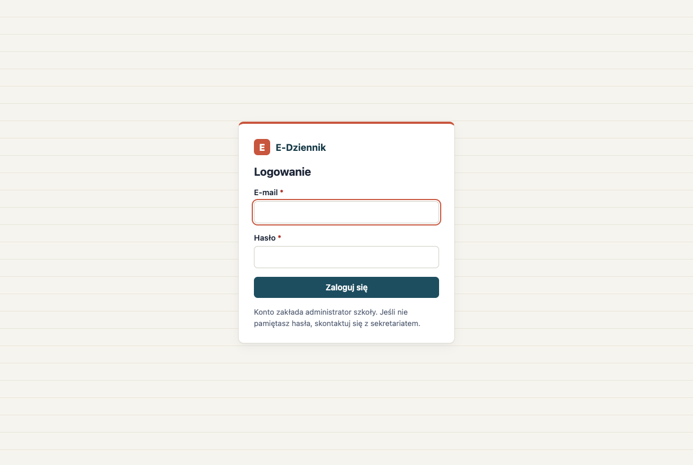

**Pulpit administratora ze statystykami**

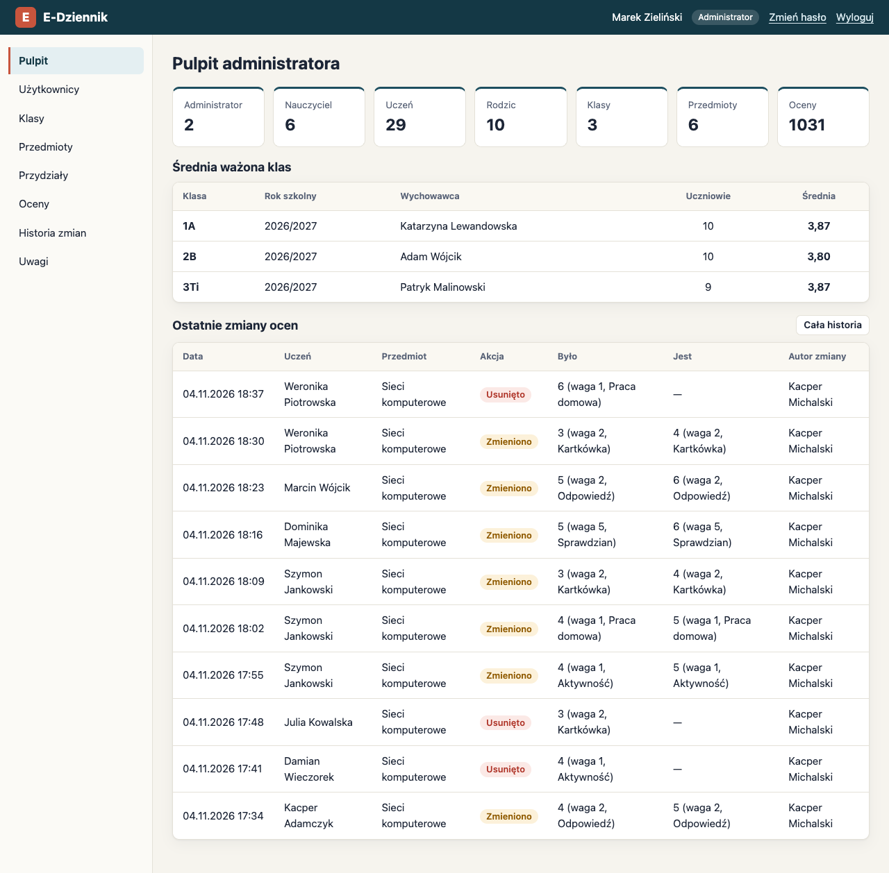

**Lista użytkowników z wyszukiwarką i paginacją**

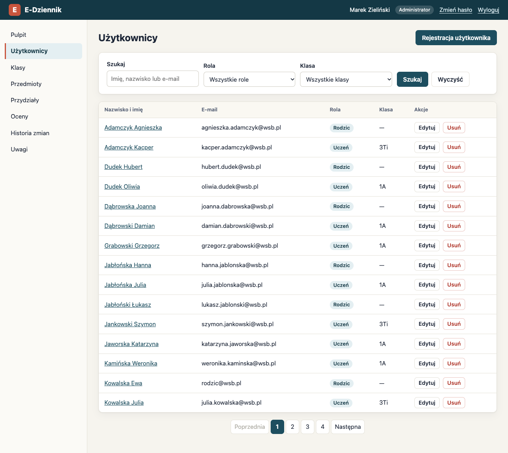

**Formularz rejestracji użytkownika**

**Komunikaty walidacji po stronie serwera**

**Arkusz ocen klasy**

**Wpis zbiorczy**

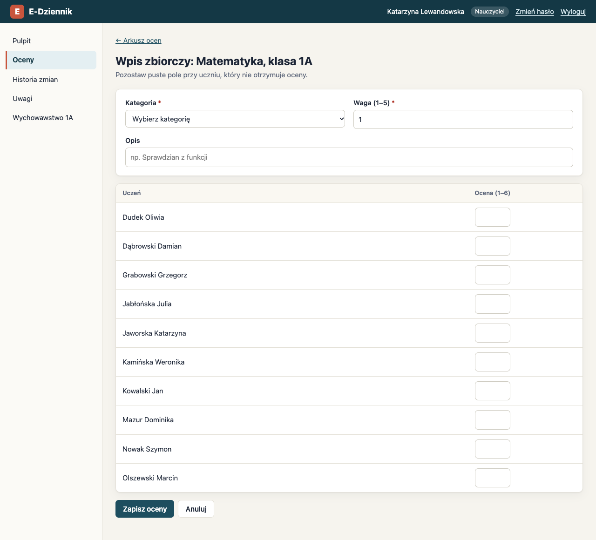

**Panel wychowawcy**

**Historia zmian ocen**

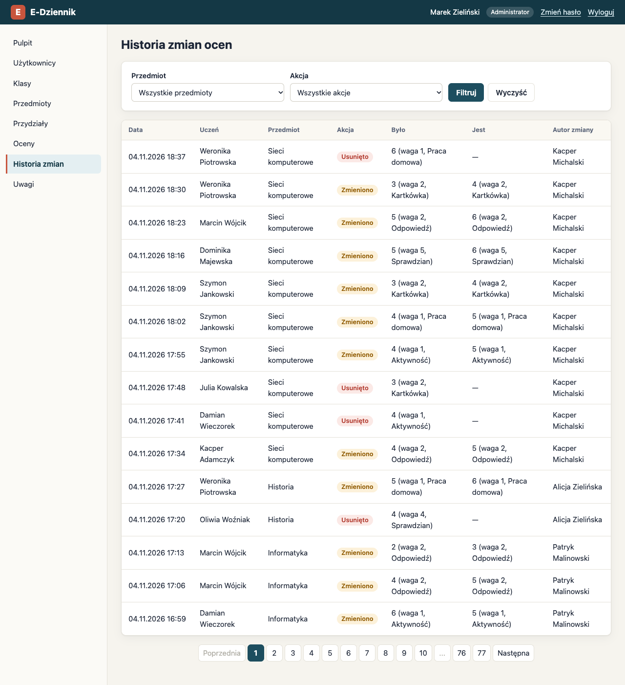

**Oceny ucznia ze średnimi ważonymi**

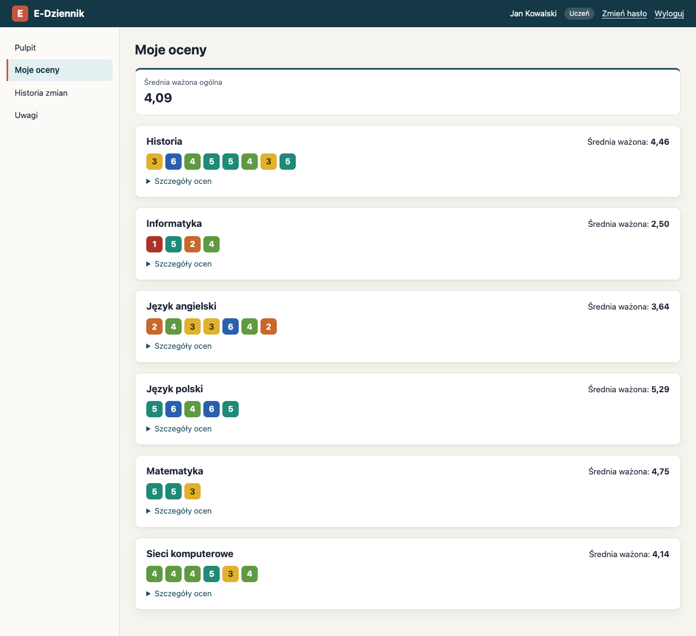

**Pulpit rodzica (lista dzieci)**

**Widok na telefonie**

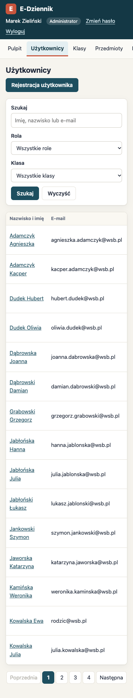
