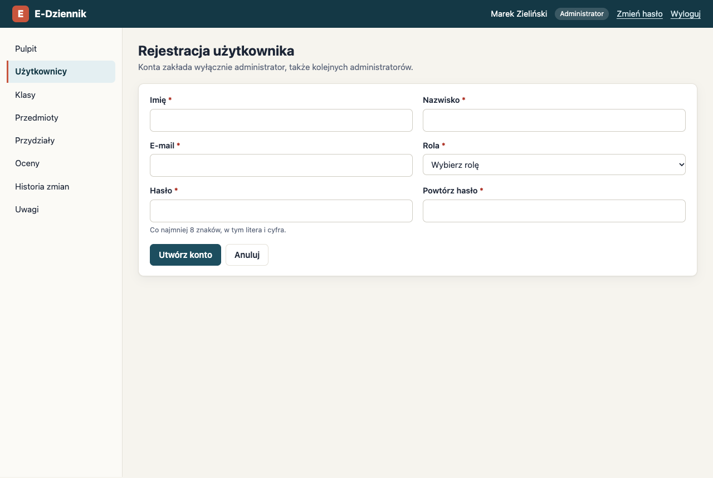
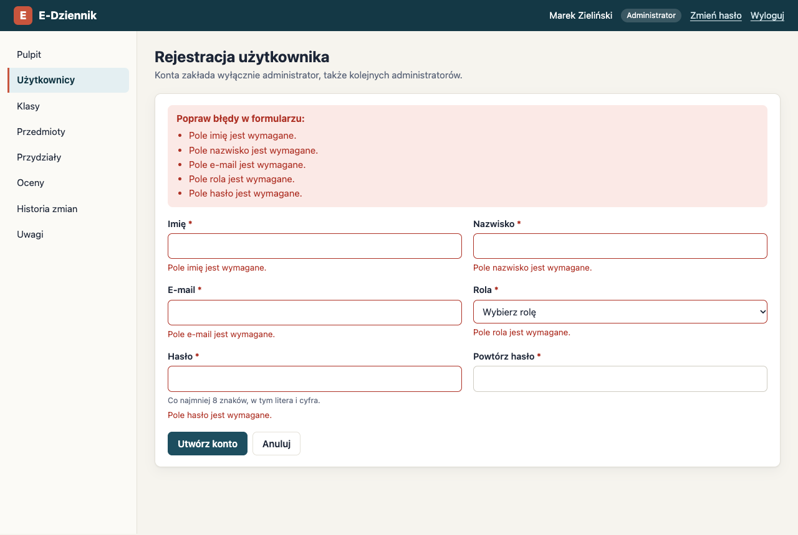
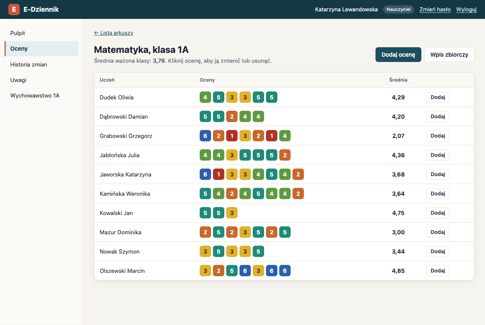
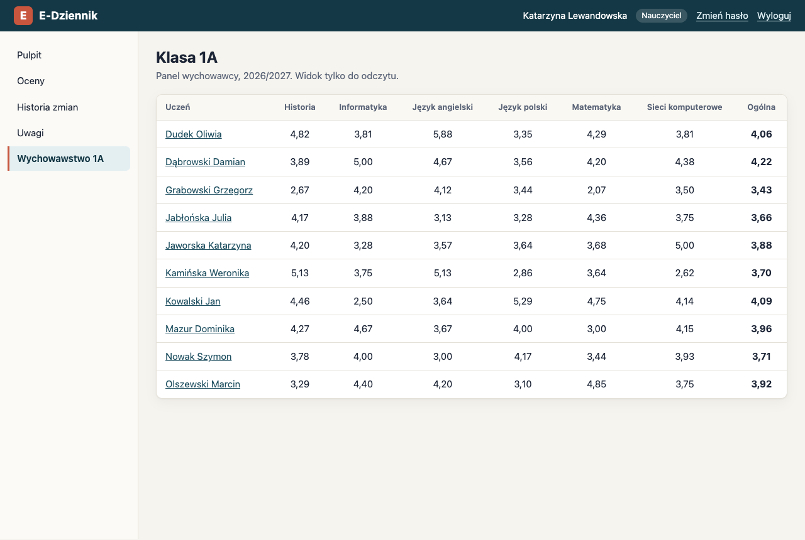
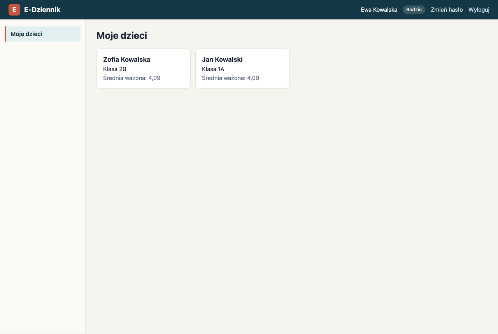

# E-Dziennik: dokumentacja

Dziennik elektroniczny dla szkoły: oceny z historią zmian, uwagi, klasy, przedmioty i przydziały nauczania, z osobnym panelem dla administratora, nauczyciela, ucznia i rodzica.

**Przedmiot:** Programowanie w zastosowaniach, WSB Poznań
**Grupa:** K37_9
**Baza danych:** `wsb_2026_k37_9`
**Zespół:** [DO UZUPEŁNIENIA: imię i nazwisko 1], [DO UZUPEŁNIENIA: imię i nazwisko 2], [DO UZUPEŁNIENIA: imię i nazwisko 3]

**Technologie:** HTML5, CSS3 (własny arkusz, bez frameworków), PHP 8.2–8.5, MariaDB, Laravel 12. Uruchomienie opisuje plik `README.md`.

## Konta testowe

Hasło każdego konta: `haslo123`

| E-mail | Rola |
|---|---|
| `admin@wsb.pl` | Administrator |
| `nauczyciel@wsb.pl` | Nauczyciel, wychowawca klasy 1A |
| `uczen@wsb.pl` | Uczeń klasy 1A |
| `rodzic@wsb.pl` | Rodzic dwojga dzieci |

## Funkcje według ról

**Administrator**
- pulpit ze statystykami, średnią ważoną klas i ostatnimi zmianami ocen,
- pełne zarządzanie użytkownikami: rejestracja konta dowolnej roli, także kolejnego administratora, lista z wyszukiwarką, filtrami i paginacją, podgląd, edycja, usuwanie,
- zarządzanie klasami, przedmiotami i przydziałami nauczania,
- wpisywanie ocen w dowolnej klasie i przedmiocie, podgląd całej historii zmian, podgląd i usuwanie uwag.

**Nauczyciel**
- pulpit z przydziałami, średnimi i ostatnimi wpisami,
- arkusz ocen klasy, dodawanie, edycja i usuwanie ocen w ramach własnych przydziałów,
- wpis zbiorczy: jedna ocena dla całej klasy naraz,
- historia zmian ocen, pochwały i uwagi,
- panel wychowawcy (tylko odczyt): średnie uczniów ze wszystkich przedmiotów, ich oceny i uwagi.

**Uczeń:** pulpit, oceny według przedmiotów ze średnią ważoną, historia zmian własnych ocen, własne uwagi. Tylko odczyt.

**Rodzic:** lista przypisanych dzieci, a dla każdego oceny, historia zmian, uwagi i dane wychowawcy. Tylko odczyt.

**Każda rola:** zmiana własnego hasła.

## Pokrycie wymagań

| ID | Wymaganie | Ekran | Plik |
|---|---|---|---|
| W1 | Rejestracja i logowanie oparte o bazę, szyfrowanie hasła | Logowanie; rejestracja wewnętrzna w panelu admina | `LoginController`, `AdminUserController` |
| W2 | Dodawanie użytkowników, szyfrowanie hasła | Użytkownicy → Rejestracja użytkownika | `AdminUserController@store`, cast `hashed` w `User` |
| W3 | Minimum trzy poziomy uprawnień | Cztery role | `User::ROLES`, `EnsureUserHasRole` |
| W4 | Różne strony po zalogowaniu | Cztery pulpity | `User::dashboardRoute`, `LoginController@store` |
| W5 | CRUD użytkowników, lista, pojedynczy użytkownik | Użytkownicy | `AdminUserController`, `views/admin/users` |
| W6 | Walidacja wymaganych pól | Każdy formularz | `app/Http/Requests`, atrybuty HTML5 |
| W7 | Wzorzec MVC | Cała aplikacja | `app/Models`, `resources/views`, `app/Http/Controllers` |
| W8 | Funkcjonalność zgodna z przeznaczeniem | Klasy, przedmioty, przydziały, oceny, uwagi | `SchoolClassController`, `SubjectController`, `TeachingAssignmentController`, `NoteController` |
| W9 | Wpisywanie ocen w oddziałach (nauczyciel, administrator) | Oceny → Arkusz ocen | `GradeController`, `BulkGradeController` |
| W10 | Wyświetlanie ocen (uczeń) | Moje oceny | `StudentDashboardController@grades` |
| W11 | Historia modyfikacji ocen (nauczyciel, uczeń) | Historia zmian | `GradeObserver`, `GradeHistory`, `GradeHistoryController` |
| W12 | Zaawansowana funkcjonalność | Wpis zbiorczy, arkusz ocen, panel wychowawcy, statystyki, średnie ważone | `BulkGradeController`, `HomeroomController`, `GradeAverageCalculator` |
| W13 | Wyrażenia regularne | Formularze użytkownika, klasy, przedmiotu i hasła | `App\Support\ValidationPatterns` |
| W14 | Paginacja, wyszukiwarka | Użytkownicy, klasy, przedmioty, przydziały, oceny, uwagi, historia | `scopeSearch`, `paginate()`, `views/pagination` |
| W15 | HTML5, CSS3, PHP 8.x, MariaDB, Laravel >= 10 | Cała aplikacja | `composer.json`, `public/css/app.css` |
| W16 | Baza `wsb_2026_k37_9`, root bez hasła, XAMPP | Konfiguracja | `.env`, `database/dump` |
| W17 | Krótka dokumentacja | Ten dokument | `docs/dokumentacja.md`, `README.md` |
| W18 | Modyfikacja kodu bez internetu | Brak zależności sieciowych | `docs/przewodnik-po-kodzie.md` |

Rejestracja jest wewnętrzna: konta tworzy administrator, co odpowiada zapisowi „rejestracja lub administrator" z wymagań.

## Baza danych

Osiem tabel. Wszystkie konta są w jednej tabeli `users`, a rolę określa kolumna `role`.

| Tabela | Przeznaczenie |
|---|---|
| `users` | konta wszystkich ról |
| `school_classes` | klasy i ich wychowawcy |
| `subjects` | przedmioty |
| `class_subject_teacher` | kto uczy jakiego przedmiotu w jakiej klasie |
| `parent_student` | powiązania rodzic–uczeń (wiele do wielu) |
| `grades` | oceny; usunięcie jest miękkie (`deleted_at`) |
| `grade_histories` | każda zmiana oceny |
| `notes` | pochwały i uwagi |

## MVC na przykładzie wpisania oceny

Nauczyciel wysyła formularz „Nowa ocena":

1. **Trasa** `POST /gradebook/{class}/{subject}/grades` w `routes/web.php` wskazuje `GradeController@store`.
2. **Middleware** `auth` i `role:teacher,admin` wpuszczają tylko zalogowanego nauczyciela lub administratora.
3. **Form Request** `GradeRequest` sprawdza prawo do tej klasy i przedmiotu (`User::canGrade`) oraz dane: zakres oceny, wagę, kategorię i przynależność ucznia do klasy.
4. **Kontroler** `GradeController@store` wywołuje model i przekierowuje do arkusza.
5. **Model** `Grade::create()` zapisuje ocenę w bazie.
6. **Obserwator** `GradeObserver@created` dopisuje wpis do `grade_histories`.
7. **Widok** `gradebook/sheet.blade.php` pokazuje arkusz z nową oceną i przeliczoną średnią ważoną.

## Wyrażenia regularne

Wzorce są w `app/Support/ValidationPatterns.php`. Te same stałe działają na serwerze i w atrybucie HTML `pattern`.

| Pole | Wzorzec | Poprawne | Odrzucane |
|---|---|---|---|
| Imię, nazwisko | `^\p{Lu}[\p{L}'\-]+(?: \p{Lu}[\p{L}'\-]+)*$` | Anna, Nowak-Kowalska | anna, Jan123 |
| Hasło | `^(?=.*\p{L})(?=.*\d).{8,}$` | haslo123 | abcdefgh, 1234567 |
| Nazwa klasy | `^[1-8][A-Z][A-Za-z]{0,2}$` | 1A, 3Ti | A1, 9Z |
| Rok szkolny | `^(20\d{2})/(20\d{2})$` i drugi rok większy o 1 | 2026/2027 | 2026/2028, 26/27 |
| Nazwa przedmiotu | `^\p{L}[\p{L}\d .,\(\)\-]{1,79}$` | Sieci komputerowe | „123" |

## Zrzuty ekranu

**Logowanie**

**Pulpit administratora**

**Lista użytkowników**

**Rejestracja użytkownika**

**Walidacja po stronie serwera**

**Arkusz ocen klasy**

**Wpis zbiorczy**

**Panel wychowawcy**

**Historia zmian ocen**

**Oceny ucznia**

**Panel rodzica**

**Widok na telefonie**

